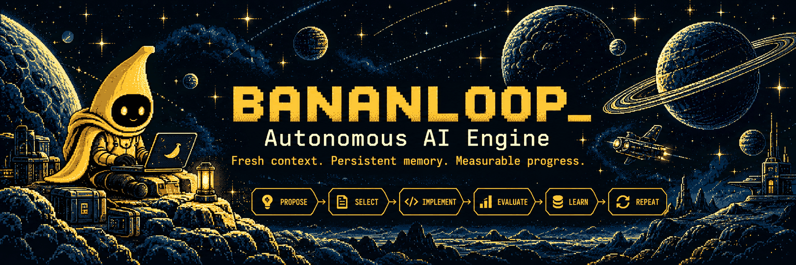
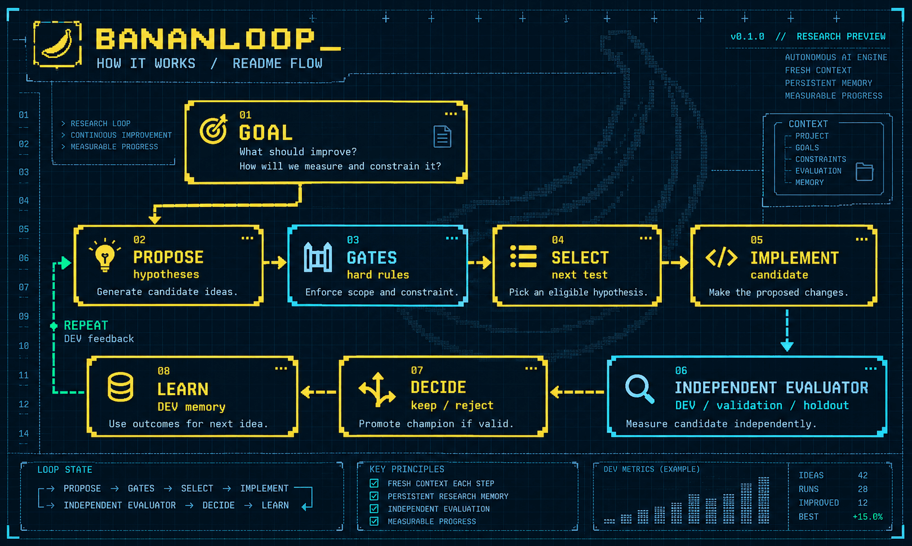

<p align="center"></p>

# BananLoop

**Your coding agent. Upgraded.**

**Fresh context. Persistent memory. Measurable progress.**

**Status:** `v0.1.0` Research Preview **candidate** — no tag or GitHub Release is published. GitHub currently reports this repository as public; the closed-preview release notes and actual visibility do not match.

[](CHANGELOG.md)

[](LICENSE)

[Why BananLoop?](#why-bananloop) · [Architecture](#how-it-works) · [Quick start](#quick-start) · [Recorded demo](#see-the-loop-in-action) · [Benchmarks](#benchmark-status) · [Expert mode](#expert-mode) · [Roadmap](docs/ROADMAP.md)


## Give your coding agent a goal. BananLoop keeps going.

**BananLoop is a local, open-source autonomous improvement loop for software repositories.** Bring a repository, a measurable goal, and a coding agent. BananLoop proposes experiments, selects promising hypotheses, applies candidate changes, independently measures outcomes, and uses the results to decide what to try next.

Instead of forgetting what failed or accepting an agent's self-reported success, it maintains a **durable experiment history**, keeps a **validated champion**, and enforces **evaluation boundaries**.

**For:** developers using Codex and other supported coding-agent backends to improve quality, performance, reliability, retrieval, or other measurable behavior. Research is one use case—not the only one.

## Why BananLoop?

**A coding agent writes and revises code. BananLoop manages the experiment around it.** You still use Codex or another supported agent, but the approval of a change depends on reproducible evidence rather than the agent declaring its own work successful.

| An ordinary coding-agent workflow | With BananLoop as supervisor |
| --- | --- |
| You or the agent decide what to try next | Hypotheses and research lessons persist across bounded experiments |
| Tests and outcomes may be managed ad hoc | An approved evaluator and guardrails determine eligibility and promotion |
| Useful failures can disappear into a conversation | Rejected candidates, explanations and the best eligible champion are recorded |
| Recovery and resource limits depend on the workflow | Campaign actions, call budgets and resumability are handled explicitly |

BananLoop is best for **repeatable, measurable improvement** — retrieval quality, regression reduction, performance, or another executable objective. It is **not** intended to replace Codex for a quick one-off edit, invent a trustworthy evaluator, or guarantee an improvement. The same agent might perform better or worse under the harness; this must be measured, not assumed.

## Built for the loop

<table>
<tr>
<td width="33%" valign="top"><strong>🎯 Goal-driven experiments</strong><br/>Start from a measurable objective and a bounded campaign.</td>
<td width="33%" valign="top"><strong>↻ Fresh context</strong><br/>Keep role prompts focused without carrying an endless chat transcript.</td>
<td width="33%" valign="top"><strong>▤ Research memory</strong><br/>Retain DEV-only evidence and lessons from rejected experiments.</td>
</tr>
<tr>
<td valign="top"><strong>⚙ Model per role</strong><br/>Configure supported models for proposal, selection, implementation and analysis.</td>
<td valign="top"><strong>▥ Independent evaluation</strong><br/>Enforce the frozen evaluator, scope gates and promotion rules.</td>
<td valign="top"><strong>⏸ Resume & budget</strong><br/>Record durable actions, restore campaigns and bound agent/evaluator calls.</td>
</tr>
</table>

**Opt-in LLM selector:** choose among eligible hypotheses; it cannot bypass the supervisor's deterministic hard gates.

> **Research Preview:** BananLoop is an experimental developer tool, not a guarantee of improvement. The evaluation contract must be independently trustworthy. Treat the default local workspace isolation as a protection against ordinary accidental leakage, **not** a security boundary for running hostile code.

## How it works

<p align="center"></p>

<details>
<summary>View text-only architecture diagram</summary>

```text
                        ┌──────────── GOAL ────────────┐
                        │ What should improve? How do  │
                        │ we measure and constrain it? │
                        └──────────────┬───────────────┘
                                       ▼
  ┌──────────┐   ┌─────────┐   ┌────────────┐   ┌──────────────┐
  │ PROPOSE  ├──►│  GATES  ├──►│   SELECT   ├──►│  IMPLEMENT   │
  │hypotheses│   │hard rules│  │ next test  │   │ candidate    │
  └────▲─────┘   └─────────┘   └────────────┘   └──────┬───────┘
       │                                               ▼
  ┌────┴─────┐     ┌────────────┐    ┌─────────────────────────┐
  │  LEARN   │◄────┤  DECIDE    │◄───┤  INDEPENDENT EVALUATOR  │
  │DEV memory│     │keep/reject │    │DEV / validation / holdout│
  └──────────┘     └────────────┘    └─────────────────────────┘
```

</details>

The **coding agent** proposes and implements. The **BananLoop supervisor** freezes the evaluation contract, checks scope, records outcomes, and decides whether a candidate may replace the current champion. The selector is advisory; it cannot bypass the deterministic gates.

## Quick start

**Requirements:** Python 3.11+, Git, and an installed/authenticated supported coding-agent CLI (Codex by default). Install BananLoop from this repository—there is no claim of a published PyPI package.

```bash
git clone https://github.com/ObiVanBanan/BananLoop.git
cd BananLoop
python -m pip install -e .
```

From **your own project's repository**:

```bash
cd /path/to/your-project
bananloop doctor --json
bananloop goal "Improve the measured quality of this project without regressions"
```

The goal command prepares an evaluator and starts a bounded campaign. If the project lacks a trustworthy evaluation oracle, BananLoop may pause and ask for operator input instead of inventing ground truth.

**See settings before spending experiment calls:**

```bash
bananloop prepare --repo . --goal "Improve measured quality without regressions"
```

### Simple vs. Expert

| Simple mode | Expert mode |
| --- | --- |
| Start with repository + goal | Explicit metric, evaluator, guards, visibility, budgets |
| Guided project preparation | Agent models and role-specific configuration |
| Fast path for suitable projects | Reproducible frozen experiment contracts |

See [the detailed CLI and campaign guide](docs/reference/cli-and-campaigns.md) for command options, Windows examples, budget controls, and privacy boundaries.

## See the loop in action

The repository includes a **deterministic fixture** that demonstrates accept → reject → accept, and a **CPU-only mini matcher** used for agent integration smoke testing.

**Reproducible offline fixture (no LLM required):**

```bash
python examples/fixture/create_fixture.py /tmp/bananloop-fixture
```

Continue with the copy-and-run CLI sequence in the [fixture walkthrough](docs/DEMO.md).

**Recorded independent smoke (October 29, 2026, one mini-matcher campaign):**

```text
  BANANLOOP / MINI MATCHER        RECORDED DEV-ONLY RESULT
  ------------------------------------------------------
  Baseline quality                          0.4375
  Proposed hypotheses                      2 eligible
  Selected mechanism        normalized_attribute_extraction
  DEV score after implementation            1.0000
  Promotion                                 ACCEPTED
  Agent calls                               3
  Evaluator calls                           2
  ------------------------------------------------------
  Single fixture run — not a public benchmark score.
```

| Stage | DEV quality |
| --- | ---: |
| Baseline | 0.4375 |
| Candidate after the selected hypothesis | 1.0000 |
| Delta | +0.5625 |

The QA run used Luna with the opt-in semantic selector, three agent calls, and two evaluator calls. This is a **single DEV-only fixture result**, not official benchmark leadership or evidence of better outcomes than standalone coding agents. See [the full demonstration and limitations](docs/DEMO.md).

## Benchmark status

**Exploratory signal, not a verified advantage:** a prior internal ten-task AutoResearchExam DEV comparison was reported as **7 wins for BananLoop vs 3 for ordinary Codex**. The run consumed substantially different resources, and the underlying per-run evidence has not yet been linked and independently reverified in this release branch. It is **not** a matched-budget result or final HOLDOUT proof.

A separate LiveCodeBench hard-60 public-example pilot compared **BananLoop Control vs BananLoop Fresh**, not standalone Codex; it cannot answer the head-to-head question. Before approving a preview, the team will repeat a **paired, independently scored Codex Direct vs Codex + BananLoop** comparison, documenting tokens/cost, validity and failures whether BananLoop wins or loses.

Details, prior pilots and outstanding acceptance checks: [Benchmark evidence register](docs/BENCHMARK_STATUS.md).

## Expert mode

Bring an existing evaluator contract if you want complete control:

```bash
bananloop init \
  --repo /path/to/project \
  --goal "Improve measured quality without regressions" \
  --eval-cmd "python scripts/evaluate.py" \
  --metric quality \
  --direction maximize \
  --target 0.85 \
  --min-improvement 0.005 \
  --editable "src/**" \
  --protect "scripts/evaluate.py" \
  --protect "tests/**" \
  --agent codex \
  --max-experiments 4

bananloop run --repo /path/to/project
bananloop report --repo /path/to/project
```

**Optional semantic hypothesis selector:** add `--selector-mode llm` to initialization (the default is `deterministic`). It reads the approved proposal portfolio and must return a gate-approved candidate ID and source-backed DEV evidence references.

**Role-specific models:** write a TOML profile, then pass `--agent-profiles path/to/agents.toml` during setup:

```toml
[default]
kind = "codex"

[roles.propose]
model = "your-proposer-model"

[roles.select]
model = "your-selector-model"

[roles.implement]
model = "your-implementation-model"
```

Backends available in the codebase include **Codex CLI**, **Pi RPC**, and a generic JSON command adapter. Compatibility depends on installed providers and model access. See the [full configuration reference](docs/reference/cli-and-campaigns.md).

## Use cases

- **Improve software quality:** make testable changes against a fixed suite or project-specific metric.
- **Optimize retrieval and ML components:** evaluate matching, ranking, and other measured changes.
- **Investigate regressions:** capture why a candidate failed and use the insight in a later hypothesis.
- **Performance tuning:** retain only changes that clear measurable latency or throughput constraints.
- **Compare ideas:** use a reproducible experiment history instead of one-off agent intuition.

## What comes next

**Current interface:** the existing CLI. Development of the experimental Pi terminal UI and Codex chat is deferred; existing read-only snapshots, persisted events and typed controls remain available independently of a UI. A future graphical client is a separate desktop application; its technology is undecided. Architecture pivots and expanded multi-step research remain deferred to v0.2+. The preview prioritizes verified reliability and honest evidence over new interface features.

Read the [roadmap](docs/ROADMAP.md), [release status](CHANGELOG.md), [preview description](docs/RELEASE_COPY.md), and [preview release protocol](docs/PUBLISH_PROTOCOL.md).

## Community & security

- [Contributing](CONTRIBUTING.md) — development, testing, and PR conventions.
- [Code of conduct](CODE_OF_CONDUCT.md) — respectful collaboration.
- [Security policy](SECURITY.md) — private vulnerability reporting.
- [License](LICENSE) — MIT.
- [Issues](https://github.com/ObiVanBanan/BananLoop/issues) — bugs and proposals.

<sub>Questionable ideas. Measurable experiments. Occasionally production.</sub>
