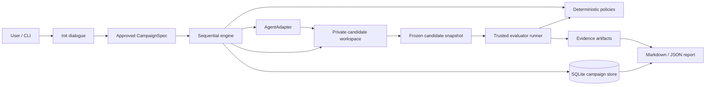

# ADR: локальный supervisor измеримых AI-campaign

## Status

**Proposed**, 2026-09-19. Решение относится к будущему standalone repository. Оно не изменяет runtime `rag_tender`.

## Task

Пользователь задаёт техническую цель, подтверждает способ измерения и ограничения, затем получает управляемую серию experiments с baseline, лучшим допустимым результатом, resume и доказательной историей. Coding-agent остаётся внешним исполнителем.

## Research Inputs

- [research_report.md](../research_report.md): активный loop, domain coupling, budgets, persistence, protected paths, unit-tests и неизвестные свойства.
- [standalone_harness_proposal.md](../standalone_harness_proposal.md): продуктовая граница, пользовательский путь, extraction matrix, риски и release criteria.
- Исследованный commit `e6e4df230edb07ac89999be4856807af9dcab119`.
- Официальные протоколы интеграции: [Codex non-interactive](https://learn.chatgpt.com/docs/non-interactive-mode), [Pi coding agent](https://github.com/earendil-works/pi/tree/main/packages/coding-agent). Первый предоставляет JSONL/structured output, второй имеет RPC/JSON режимы; версии фактических CLI будут фиксироваться adapter-ом.

## Context

Прототип имеет stage engine, public/hidden guards, текущий corpus evaluation, champion, experiment memory и специализированные recovery paths. Общие функции подменяются несколькими wrappers, state представлен словарями и несколькими файлами, Git commit и state completion разнесены во времени.

Hardcoded RAG metrics и Qdrant/LD preflight не являются подходящим контрактом для других задач. Анализ также обнаружил разные источники primary evidence и `GOAL_MET`, неполный candidate cache fingerprint, post-hoc path protection и отсутствие универсального денежного/time enforcement. Подробные источники приведены в research report.

## Decision

Создать один local Python CLI supervisor с явной последовательной state machine. Domain logic остаётся в evaluator проекта. Принять versioned typed contracts; Pydantic для validation, SQLite для campaign state/events/reservations, файловые артефакты для больших outputs.

Четыре интеграционные границы: `AgentAdapter`, `Evaluator`, `WorkspaceManager`, `CampaignStore`. Acceptance/stop/budget predicates принадлежат core. Один executor может выполнять planning и implementation в разных invocations. Отдельный routing engine не требуется.



Agent output не является доверенным verdict. Evaluation measurements поступают из evaluator runner, а не из implementer self-report. Store и approved spec принадлежат supervisor. Схема показывает логические границы; OS-level изоляция зависит от execution backend и проверяется отдельно.

## Alternatives

### Option A: выделить текущий harness почти целиком

- Pros: максимальная начальная преемственность, уже существуют многочисленные edge-case fixes.
- Cons: fixed ROOT, domain metrics, обязательный Qdrant, OpenSpec flow, monkey-patching и legacy migration semantics переходят в публичный API.
- Decision: отклонить как основу core. Переносить отдельные утилиты, инварианты и regression scenarios.

### Option B: небольшое standalone ядро и project evaluator bridge

- Pros: независимость от `rag_tender`, небольшой публичный contract, понятная проверка переносимости вторым проектом/adapter.
- Cons: state machine и recovery необходимо реализовать и проверить заново; это не упаковка за несколько дней.
- Decision: принять.

### Option C: сразу строить configurable workflow/multi-agent platform

- Pros: гибкий порядок стадий и execution topology.
- Cons: текущий scope требует один последовательный loop; расширяется объём публичных контрактов и recovery cases до проверки спроса.
- Decision: отложить. Не вводить DAG/queue/orchestrator framework без потребности, которую текущая machine не покрывает.

### Option D: JSON state + JSONL journal вместо SQLite

- Pros: легко читать и переносить prototype utilities.
- Cons: counters, active stage и decision history нужно вручную согласовывать после crash.
- Decision: SQLite является source of truth; JSONL/Markdown только export. Крупные файлы всё равно сохраняются вне DB с digest и completion receipt.

### Option E: linked worktree исходного repository вместо частной копии

- Pros: меньше дискового копирования, быстрый checkout.
- Cons: shared Git metadata/refs требуют дополнительных ограничений относительно пользовательского repository; это не security boundary. [Git worktree documentation](https://git-scm.com/docs/git-worktree).
- Decision: private local clone по умолчанию. Linked worktree внутри специально выделенного repository может быть поздней оптимизацией. Supervisor не выполняет destructive cleanup пользовательского checkout.

## Contracts

### API

HTTP API: **Not applicable** в v0.1; public boundary является CLI и adapter protocols.

| CLI | Контракт |
| --- | --- |
| `harness init` | Discovery, диалог, разрешённое baseline measurement, preview и approval; результат DRAFT либо READY |
| `harness run` | Запускает только approved spec с matching hash; не изменяет его на основании prompt |
| `harness status [--json]` | Campaign/stage/champion/budget/stop reason, без повторных agent calls |
| `harness resume` | Reconcile активное action, проверить fingerprint и budgets, продолжить сохранённую campaign |
| `harness stop` | Запросить отмену owned process tree, сохранить checkpoint и champion |
| `harness report` | Детерминированный Markdown/JSON export из durable records |

Draft и approval привязаны к spec hash. Изменение target/scope/budget требует нового approval event. Изменение evaluator/dataset/protocol делает прежние measurements несопоставимыми: новая campaign с новым baseline, при необходимости с provenance link на предыдущую. Расширение бюджета не обнуляет spent amounts.

Campaign v0.1 начинается с выбранного committed snapshot. Dirty source требует явного выбора начать от этого commit либо отложить запуск; автоматические stash/reset и неявное исключение пользовательских изменений запрещены. Baseline и candidate исполняются в одинаково подготовленной private workspace environment, отдельно от source checkout. Подготовительные commands также требуют разрешения и входят в учёт ресурсов.

#### AgentAdapter

```text
probe() -> AgentCapabilities
execute(AgentTask, ExecutionContext) -> AgentResult
cancel(action_id) -> CancellationResult
```

`AgentTask`: `schema_version`, `task_id`, `role=propose|implement`, approved goal excerpt, bounded context, hypothesis, required result schema. Proposer output: hypothesis/rationale/expected_effect/falsification/scope/mechanism_key/prior_experiment_refs либо `NO_HYPOTHESIS`. Implementer output: summary, claimed changed paths, verification notes и blockers; реальные paths определяет supervisor.

`ExecutionContext`: `action_id`, managed workspace, approved capabilities, explicit env references, deadline, reserved budget, output directory. Prompt и result files не могут задавать новый cwd, credentials или расширять permissions.

`AgentResult`: `status=completed|failed|cancelled|unknown`, validated payload, adapter/model/version, timing, usage items, logs/artifact refs, provider call/session IDs при наличии. `UsageItem` содержит unit/amount/source/quality (`actual|estimated|unknown`); отсутствующий расход не заменяется нулём.

Первый adapter реализует Codex transport; `CommandAgentAdapter` требует wrapper, принимающий JSON request и выдающий schema-valid JSON result. CLI exit 0 без подходящего structured result является `AGENT_PROTOCOL_ERROR`. Raw token events не означают, что adapter обеспечивает hard USD limit.

#### Evaluator

```text
evaluate(EvaluationRequest, ExecutionContext) -> EvaluationResult
```

`EvaluationRequest`: `evaluation_id`, frozen candidate snapshot, `evaluator_id/version/hash`, dataset/protocol/environment fingerprints, repeats/seed policy и supervisor-owned output destination.

Минимальный result, иллюстративные значения:

```json
{
  "schema_version": 1,
  "status": "ok",
  "metrics": {
    "recall_at_5": {"value": 0.81, "unit": "ratio", "n": 100},
    "latency_p95": {"value": 225.0, "unit": "ms", "n": 1000}
  },
  "checks": {
    "acceptance_tests": {"passed": true, "executed": 263, "skipped": 0}
  },
  "artifacts": ["results/cases.json"]
}
```

Result schema принадлежит harness, а числа производит утверждённый evaluator. Supervisor добавляет binding к action/candidate/protocol, timestamps и hash output; не доверяет self-declared candidate ID из arbitrary JSON. Artifacts разрешаются только внутри owned output directory с проверкой symlink/reparse traversal.

Варианты `status`: `ok`, `invalid`, `infra_error`, `cancelled`. Провал quality/guardrail при корректно выполненной проверке остаётся `ok` с плохими metrics/checks, затем policy принимает `REJECT`. Crash, malformed JSON и missing output не считаются доказанным ухудшением качества.

Validation: все required metrics присутствуют, имеют конечные числовые значения и ожидаемые units/ranges; sample count положителен и соответствует protocol; dataset/case IDs и skips проверены. `NaN`, `Infinity`, missing value, пустой набор или неожиданно пропущенные cases дают `INVALID_EVALUATION`. Custom commands по умолчанию возвращают JSON, а не произвольные regex-friendly логи. Test-command adapter нормализует ожидаемый test-failure exit отдельно от инфраструктурного crash.

Команды задаются `argv` массивами; shell interpolation и произвольная строка из agent output не используются. Shell script допустим как явно утверждённый executable artifact. Setup/build/index команды имеют timeout, budget и declared outputs; автоматически предложенная моделью команда не становится разрешённой.

#### Acceptance и target

Один `MetricSpec`: name, unit, direction, valid range, aggregation/repeats, target, min_improvement. В v0.1 один primary objective, любое небольшое число conjunctive guardrails.

Для maximize incremental effect `candidate - champion`; для minimize `champion - candidate`. Принимаем, если effect >= positive `min_improvement`, comparisons valid, все guard predicates true и mandatory review approval получено при выбранном режиме. Равенство и inconclusive не меняют champion.

Guard имеет explicit anchor `absolute|baseline|champion`, operator, bound и tolerance. Default для допустимого cumulative ухудшения: baseline anchor. Relative thresholds при нулевом reference не вычисляются: init требует absolute limit. Relative target один раз преобразуется из измеренного baseline и закрепляется approval; его не пересчитывают от каждого champion.

`GOAL_MET` означает target, guards и обязательные final checks на одном подтверждённом candidate. `best_observed` и `best_feasible` сохраняются отдельно. Acceptance промежуточного улучшения не означает достижения target.

### Data

Минимальные таблицы:

| Таблица | Содержание и ключи |
| --- | --- |
| `campaigns` | ID, repository ID, spec JSON/hash/version, lifecycle, baseline/champion refs, stop reason |
| `experiments` | ID, campaign ID, hypothesis, mechanism key, rationale, parent snapshot, previous experiment links |
| `attempts` | ID, experiment ID, ordinal, current stage, snapshot, status, scientific-completion flag |
| `actions` | Unique action ID, attempt/stage, input hash, intent/status, process identity, receipt, error |
| `evaluations` | ID, action ID, candidate/protocol refs, result/hash, comparison eligibility |
| `decisions` | Unique attempt decision, predicates/reasons, selected champion, baseline/champion deltas |
| `reservations` | Action/resource, reserved/consumed/settled amounts и quality |
| `events` | Monotonic sequence, timestamp, entity refs, type и bounded payload |
| `artifacts` | Hash, size, type, owned relative path, visibility, producing action |

SQLite migrations имеют explicit schema version и backup перед изменением. Неизвестная future version открывается только для безопасного чтения либо отклоняется. Default storage local disk, не network share.

Файлы пишутся в action-specific temp path, затем atomically renamed; completion receipt содержит hashes. Только после этого transaction фиксирует completed stage. Осиротевшие outputs не считаются measurements без receipt. Shared memory между разными campaign не используется для автоматического acceptance; импортированное знание всегда содержит provenance.

`repository_id` создаётся локально и проверяется против выбранного Git root/repository identity. Branch name сам по себе не является идентификатором. User-state root содержит private clone, DB, artifacts и reports. Approved project config не содержит tokens/passwords.

Runtime lifecycle:

```text
DRAFT -> BASELINING -> READY -> RUNNING
RUNNING -> PAUSED_INFRA | PAUSED_NEEDS_INPUT | FINALIZING | STOPPED
PAUSED_* -> RUNNING                  (same spec, reconciled state, valid budget)
FINALIZING -> GOAL_MET | STOPPED | PAUSED_INFRA
```

Attempt stages: `PROPOSE -> EXECUTE -> SNAPSHOT -> VERIFY -> MEASURE -> DECIDE -> PROMOTE/REJECT -> RECORD`. Все stage transitions сохраняются. Для baseline уже достигшего target EXECUTE не нужен.

### Events / Jobs

Distributed queue: **Not applicable**. Один supervisor и одна активная attempt на campaign. OS lock и store constraints предотвращают второго writer; разные campaigns не должны совместно мутировать external resource.

До side effect transaction создаёт action intent и budget reservation. Runner получает immutable action ID и deadline. После выполнения записывает receipt и переводит action в completed/failed. Повторный completion с тем же ID не увеличивает counters и не меняет решение повторно.

Resources: agent calls, evaluation calls, preparation calls, attempts, evaluated experiments, wall deadline. Evaluation repeats и baseline входят в расходы. Scientific count увеличивается один раз для валидно оценённого experiment, включая guard rejection; infrastructure/protocol failures увеличивают attempts/errors, но не scientific count. Evaluation crash не признаётся валидной отрицательной метрикой.

Retries ограничены per-action и campaign counters. Допускается retry подтверждённой transient infrastructure error. Неизвестный исход остаётся `UNKNOWN_OUTCOME`, расход зарезервирован; сначала reconciliation. Semantic failure, scope violation и guard rejection не повторяются как «network retry».

Promotion protocol:

1. Supervisor сохраняет immutable candidate commit/tree и verified evaluation refs до decision; agent уже остановлен.
2. Transaction фиксирует `PROMOTION_INTENT(expected_champion, candidate, decision_id)`.
3. Supervisor обновляет только собственный champion Git ref через compare-and-swap с expected previous ref.
4. Transaction завершает intent, пишет новый champion, decision/event и final attempt status.
5. При resume ref равен candidate -> завершить запись без нового commit; ref равен expected -> повторить CAS; иное состояние -> `PAUSED_NEEDS_INPUT`.

Git и SQLite не образуют общую транзакцию. Этот протокол делает promotion восстанавливаемым; он не обещает exactly-once выполнение внешних API. Rejected snapshot сохраняется как evidence по retention policy, но не становится champion. Cleanup касается только resolved paths внутри managed root; пользовательский repository не reset/clean.

Resume проверяет process ownership/start identity и наличие ещё работающих children прежде, чем запускать новое действие. Watchdog/process backend обязан ограничивать wall time и завершать owned process tree, включая при потере supervisor. Для Windows и POSIX нужны отдельные integration cases. Detached services и remote jobs без управляемой отмены в v0.1 не запускаются.

### Errors

| Error | Поведение |
| --- | --- |
| `INVALID_SPEC` / `UNSUPPORTED_CAPABILITY` / `UNSUPPORTED_BUDGET` | Run не начинается; объяснить конкретное неподдерживаемое требование |
| `BASELINE_FAILED` / `UNSTABLE_EVALUATION` | Не объявлять baseline измеренным; вернуться к подготовке/исправлению protocol |
| `AGENT_PROTOCOL_ERROR` | Сохранить logs/result, ограниченный retry только по declared rule |
| `SCOPE_VIOLATION` / `EVALUATOR_CHANGED` | Отклонить attempt до expensive measurement; сохранить diff и причину |
| `INVALID_EVALUATION` / `ENVIRONMENT_DRIFT` | Не сравнивать и не принимать candidate; pause для восстановления comparable setup |
| `INFRA_UNAVAILABLE` | Bounded retry, затем checkpoint/pause |
| `UNKNOWN_OUTCOME` | Reconcile receipt/process/provider status; не дублировать действие автоматически |
| `STATE_CONFLICT` | Pause; не выбирать произвольно между Git и DB |
| `CANCELLED` | Зафиксировать unfinished stage, settle known usage, сохранить champion |

User-visible stop reasons отличны от error codes, чтобы «не достигнута цель», «инфраструктура недоступна» и «исчерпан бюджет» не смешивались. Report содержит outcome, baseline, best feasible, best observed с причинами недопустимости, delta, experiments, accepted changes, costs с coverage, stop reason и untested next directions. Numeric sections строятся из store без LLM; optional narrative не может менять числа/verdict.

## Security

Trust model v0.1: доверенный локальный проект, ограниченный existing coding executor, supervisor-owned policy/evaluation. Это не среда безопасного исполнения произвольного враждебного кода.

Внутри поддерживаемой policy executor не получает запись в store, frozen assets, approval record, Git champion refs и evaluation output. В private clone нет исходного remote/token configuration; agent не имеет полномочия push/deploy. Path canonicalization учитывает Windows case/reparse points и POSIX symlinks. Allowed writes проверяются backend-ом и diff guard; одно post-hoc сравнение paths не объявляется предотвращением side effects.

Private clone исключает необходимость rollback пользовательского checkout, но не является filesystem sandbox. Процесс с неограниченным доступом к диску способен выйти из clone; запрет обеспечивает только проверенный execution backend. Git hooks/global configuration также не должны неявно запускать сторонние действия в managed clone.

Credential policy использует env allowlist и process-specific secret references. Provider credentials нужны agent transport, но не произвольным evaluator subprocess; обратное также верно. Repository instructions, generated code и logs считаются недоверенными данными относительно supervisor policy. Они не расширяют budget, сеть или filesystem scope.

Capabilities проверяются до запуска: adapter transport и execution backend раздельны. Произвольный CLI без проверяемого sandbox не допускается к campaign с обязательным запретом доступа/действий. Локальный trusted mode не маркируется строгой изоляцией. Разрешения auto-режимов меняют необходимость подтверждения в пределах spec, а не разрешённые действия.

Frozen evaluation assets включают transitive scoring helpers/config и case manifest. Там, где scorer выполняется в одном процессе с candidate code, гарантии ограничены; cryptographic hashes подтверждают версию файлов, но не честность произвольного исполняемого кода. Для строгой независимости нужен отдельно изолированный scorer или black-box service evaluation.

Private holdout не монтируется agent-у и candidate runtime; labels/row errors не входят в prompts/log exports. Сам candidate может видеть входы, необходимые для inference, поэтому изоляция scorer и отсутствие обратной выдачи labels обязательны. Если backend этого не обеспечивает, strict holdout campaign блокируется. Встроенный универсальный backend для такой проверки отложен.

Hard currency cap разрешается только при проверенной верхней границе всех billable actions. Иначе отображается estimate/unknown и используется исполнимый count/time contract. Подписки, tool costs и evaluation API calls не игнорируются. Remote cancellation и расходы после disconnect не считаются решёнными локальным timeout.

## Testing Strategy

Тестирование относится к будущей реализации; текущий unit-suite `rag_tender` уже проверен отдельно в research report.

- Policy: maximize/minimize, baseline/champion anchors, relative-zero error, missing/NaN metrics, sample loss, cumulative regression, baseline already at goal, target/final consistency, budget-vs-target precedence.
- State/budget: reserve-before-launch, failure settlement, exactly-once counters, pause deadline, no budget reset on resume, bounded retries.
- Crash matrix: до/после launch, receipt, evaluation persistence, decision, Git CAS, DB completion; recovery никогда не принимает неизвестный snapshot и не повторяет promotion.
- Workspace: dirty source остаётся неизменным; staged/untracked/renamed/binary files влияют на tree identity; late content mutation инвалидирует result; original refs не меняются.
- Evaluation protection: deleted/skipped tests, edited grader/import helper/config, malformed result, stale cache, path traversal и доступ к protected outputs блокируются.
- Adapter contract: Codex + fake fixtures для errors/usage; второй реальный command wrapper smoke. Unsupported cancel/isolation/cost capability выявляется preflight.
- Runtime integration: Windows и POSIX process-tree termination, orphan recovery, locks, Unicode filenames, CLI executable resolution. Local fake processes вместо платных calls в CI.
- Product acceptance: три разных project integrations и release gates из proposal. Live calls выполняются только в явно разрешённом dogfood budget.

## Consequences

Core станет меньше domain-specific runtime, но потребует явных моделей и recovery протокола. SQLite добавляет migration responsibility, сохраняя читаемые JSON/Markdown exports. Private clone требует больше диска; artifact retention/cleanup проверяется как отдельное действие над owned paths.

`rag_tender` не зависит от нового пакета до отдельного решения о подключении. Новый пример вызывает существующий evaluator через wrapper; обратная совместимость старого `state.json` в v0.1 не обещается. Старые evidence могут импортироваться только как historical records с явно указанной provenance, без продолжения старой active stage.

Публикация/merge результата исключены из automation v0.1. Пользователь получает private branch/commit bundle или patch для review. Stop/failed campaign возвращает последний подтверждённый champion, а не рабочее дерево незавершённого агента.

## Open Questions

| Вопрос | Тип | Принятое допущение / действие перед реализацией |
| --- | --- | --- |
| Нужен ли strict USD cap с первого релиза? | Scope decision | Default count/time budgets; strict money backend отдельный объём |
| Нужна ли приватная final evaluation сразу? | Scope decision | Встроенная strict holdout isolation отложена; existing isolated evaluator допустим после проверки |
| Какой второй CLI проверять? | Не блокирует дизайн | Предпочтительно Pi; version/protocol/cancel проверить коротким contract spike |
| Насколько стабилен project evaluator? | Блокирует конкретную campaign | Измерить baseline/repeatability до approval/run |
| Какие ресурсы можно snapshot/reset вне Git? | Блокирует интеграцию с mutable services | v0.1 read-only или отдельные disposable ресурсы; production mutation исключена |
| Какие backend capabilities доступны на Windows/POSIX? | Блокирует обещания enforcement | Подтвердить process-tree cancellation и permissions интеграционными проверками до release |
| Package name и license | Блокирует публикацию, не дизайн | Рабочее имя `harness`; выбрать владельцу repository перед publication |

Эти вопросы не требуют изменения `rag_tender` для продолжения проектирования. Следующий шаг после принятия proposal: отдельный repository и план реализации на основе данного ADR; в текущей работе код нового продукта не создаётся.