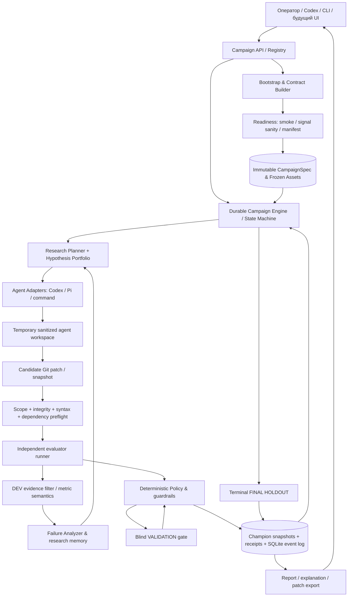
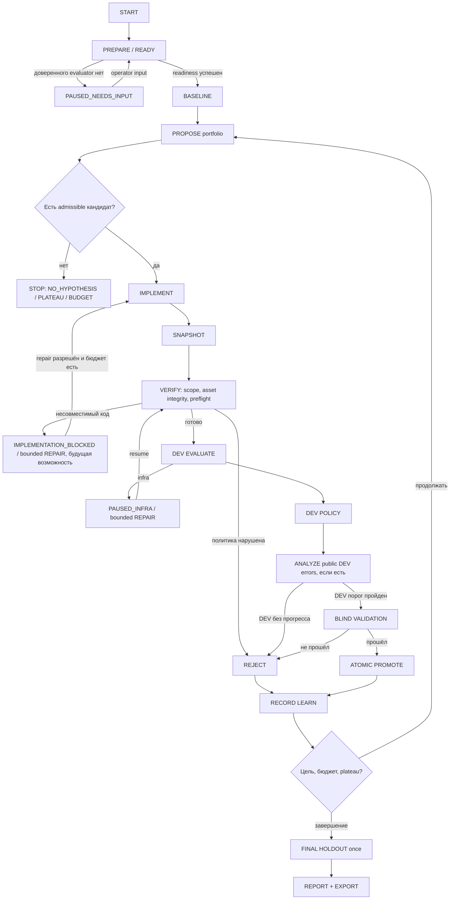
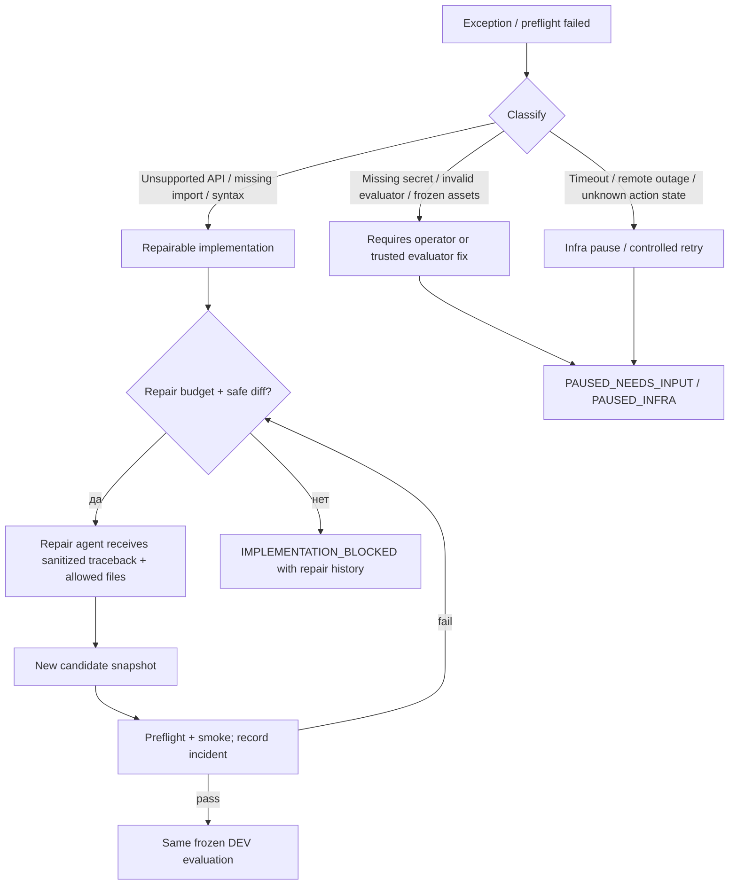

# BananLoop — PRD, бизнес-логика, архитектура и план развития

**Версия:** 1.0 · **Дата:** 21 октября 2026 года  
**Репозиторий:** https://github.com/ObiVanBanan/BananLoop  
**Источник продуктовой цели:** https://github.com/ObiVanBanan/BananLoop/issues/28  
**Текущая интеграционная работа:** https://github.com/ObiVanBanan/BananLoop/pull/47 (`codex/dev-failure-reflection-v3-20261021`, HEAD при сверке `1dd0a83`)  
**Статус документа:** проект целевой архитектуры; описанные будущие возможности не считаются реализованными.

## 1. Бизнес-задача

### Проблема

Улучшение качества программного проекта с помощью coding agents сегодня требует постоянной работы человека: выбрать гипотезу, поручить изменение, подготовить одинаковые условия измерения, проверить метрики и регрессии, отсеять шум, отклонить неудачные изменения, проанализировать ошибки, не утечь в тестовые ответы и продолжить эксперимент. Если агент сам меняет evaluator, критерии или ориентируется на закрытые метки, рост метрики может оказаться ложным. Если агент пишет несовместимый код, исследование застревает на инфраструктурной ошибке.

### Целевой пользователь

- Инженер/ML-инженер с Git-репозиторием и существующей или явно утверждённой процедурой измерения.
- Команда разработки, оценивающая RAG/retrieval, качество ML, производительность либо исправление регрессий.
- QA/исследователь, которому важны воспроизводимость, ограничения бюджета, причины решений и сравнение с базовой версией.

### Ценность

**Пользователь передаёт репозиторий, цель и ограничения. BananLoop самостоятельно организует ограниченную серию воспроизводимых экспериментов, выбирает улучшения только по утверждённым правилам и возвращает лучший подтверждённый результат либо честное объяснение отсутствия результата.**

BananLoop не должен гарантировать прирост, автоматически деплоить результат, изобретать с нуля доверенный benchmark, предоставлять полноценный sandbox для вредоносного кода или обещать жёсткий денежный лимит без внешнего metering.

### Бизнес-результат одной кампании

1. **CHAMPION_IMPROVED:** существует проверенный candidate, прошедший DEV, независимую validation и обязательные проверки; результат доступен как Git patch и подтверждённые receipts.
2. **NO_VALIDATED_IMPROVEMENT:** доказуемо показано, какие механизмы проверены и почему они не прошли утверждённые требования.
3. **PAUSED_ACTIONABLE:** исследование приостановлено с конкретной безопасной инструкцией, что исправить/предоставить, без потери состояния.
4. **BASELINE_ALREADY_MET_TARGET:** исходный проект уже соответствует цели — нельзя выдавать это за полученный прирост.
5. **FINAL_HOLDOUT_REJECTED:** кандидат либо terminal champion не достиг абсолютной финальной цели. Финальная оценка не используется для адаптивного планирования.

## 2. Продуктовые границы и принципы

1. **Core владеет решением.** Агент предлагает и кодит. Только core читает approved contract и принимает ACCEPT/REJECT.
2. **Evaluator независим от кандидата.** Benchmark, референсы, протокол и исходные данные защищены от implementer.
3. **Данные по уровням:** DEV допускается для исследования только в явно разрешённом объёме; validation используется supervisor для независимого решения, holdout — для однократной финальной оценки.
4. **Доказательства, не догадки.** Score, observation, hypothesis и confirmed mechanism — отдельные сущности. Снижение FN при cutoff не является автоматическим объяснением изменения PR-AUC.
5. **Ошибки реализации не являются научным провалом.** ImportError/TypeError/timeout/сбой сервиса → operational incident и bounded repair, а не опровержение ML-гипотезы.
6. **Бюджет и возобновление.** У каждой операции durable action ID, request hash и расход ресурсов. Повтор не дублирует завершённые вызовы.
7. **Safe failure.** При нарушении evaluator integrity, leakage либо невозможности проверки остановиться/отклонить кандидата; не смягчать ограничения без решения оператора.
8. **Универсальный core.** Специализация на типах задач живёт в evaluation contracts, diagnostics adapters, metric semantics и профилях агентов, а не в ветках `if project == rag`.

## 3. Роли

| Роль | Задача | Что запрещено |
|---|---|---|
| Operator | Поставить цель, ограничения, утвердить contract, выбрать экспорт | Не нужен на каждой итерации |
| Bootstrap/Contract Builder | Найти существующий evaluator, сконфигурировать/подготовить адаптер, проверить readiness | Менять production код или выдумывать золотые метки |
| Research Planner | Читать разрешённую DEV-память и предложить портфель гипотез | Получать validation/holdout labels, изменять критерии ACCEPT |
| Implementer | Изменить разрешённые production файлы по выбранной гипотезе | Читать evaluator/gold/protocol или менять protected paths |
| Failure Analyst | Исследовать только допустимые DEV-ошибки и сформировать generalized hypotheses и discriminating tests | Утверждать причинность без подтверждения, записывать кейсовые секреты в память |
| Independent Evaluator | Вычислять frozen DEV/validation/holdout метрики | Давать агенту закрытые примеры или изменять протокол между кандидатами |
| Policy Engine | Детерминированно принимать решения, управлять бюджетом, plateau, promotion | Самостоятельно переписывать одобренную цель |
| QA/Reviewer | Проверить воспроизводимость, ограничения и итоговый патч | Не требуется для каждого измерения |

## 4. Целевая архитектура



**Принципиальная граница:** validation/holdout **не проходят** через `DEV evidence filter → Research Planner`. Даже при отрицательном решении validation агент получает только уже разрешённую DEV-историю. В будущей реализации лучше физически разделить наборы DTO и ACL, не полагаясь лишь на инструкции промпта.

### 4.1 Слои и модули

| Слой | Назначение | Текущая база | Будущее усиление |
|---|---|---|---|
| Interaction | `goal`, `start`, `prepare`, `status`, `resume`, `report`, экспорт | `cli.py`, `registry.py`, `codex_hook.py` | Natural-language approval & live research dashboard |
| Campaign governance | Frozen spec, scope, budget, event log, stop policy | `contracts.py`, `engine.py`, `store.py`, `budget.py` | Versioned contracts, explicit tiers, audit rules |
| Bootstrap | Discovery, staged evaluator, readiness | `bootstrap.py`, `wizard.py`, `readiness.py` | Typed diagnostics profile, path auto-binding, suggested fixes |
| Research intelligence | Hypotheses, DEV lessons, failed families, portfolio, reframe | `research.py`, `metric_semantics.py` | Evidence graph, cross-experiment causal tests, semantic-family consistency |
| Agents | Propose, implement, analyze | `agents/codex.py`, `agents/pi.py`, command adapter | Repair role, capability-driven adapters |
| Workspace & checks | Protected files, patching, syntax/API, anti-leakage | `workspace.py`, `candidate_preflight.py`, `integrity.py`, `leakage.py` | Safe bounded repair loop, general dependency compatibility checks |
| Measurement & policy | DEV/validation/holdout, receipts, accept/reject | `evaluators/`, `policy.py`, `evaluator_binding.py` | Typed metric profiles, paired confidence/noise diagnostics |
| Reports | Champion, failed hypotheses, measured evidence, exports | `report.py`, `export.py` | Compact research timeline and explanation UI |

## 5. State machine и алгоритм



**Важно:** `FIX → IMPLEMENT` — целевой дизайн self-healing, а **не** заявленная текущая функциональность. Сейчас ошибки предварительной проверки обычно приводят к `IMPLEMENTATION_BLOCKED` и отказу; ошибки evaluator способны оставить кампанию `PAUSED_INFRA`.

### 5.1 Детерминированная бизнес-логика решения

```text
baseline = evaluate(frozen_champion, DEV)
for each reserved experiment while budgets and policy allow:
    evidence = DEV-only allowlisted history/capsules/metrics
    portfolio = proposer(evidence, remaining_budget)
    selected = core.select(portfolio, novelty/falsifiability/scope/budget)
    candidate = implement_in_sanitized_workspace(selected)
    snapshot = commit_candidate_patch()
    verify_evaluator_unchanged_and_scope(snapshot)
    if implementation_incompatible:
        record OPERATIONAL / bounded repair if safe and approved
        continue without declaring a scientific failure
    result = independent_evaluator(snapshot, frozen_DEV)
    dev_decision = deterministic_policy(result, champion_dev)
    lesson = analyze_public_DEV_failures(result) if supplied and allowed
    if dev_decision passes:
        validation_decision = independent_validation_gate(snapshot)
        if validation_decision passes: atomically_promote(candidate)
    record receipts, outcome, evidence, spend, and research_state
    if plateau: switch hypothesis family once within remaining budget
final_holdout(terminal_champion) # terminal only; never returns to planner
return report + champion export + reasons
```

### 5.2 Rules catalogue

| ID | Правило | Зачем |
|---|---|---|
| BR-01 | Любой эксперимент привязан к immutable approved contract (`hash`) | Не менять цель посреди кампании |
| BR-02 | Изменение evaluator, frozen inputs или protected paths отвергается до DEV | Anti-gaming |
| BR-03 | Продвижение только при DEV + validation + guardrails | Исключить ложный champion |
| BR-04 | Holdout один раз на terminal champion, без возврата его данных планировщику | Отсутствие test-set overfitting |
| BR-05 | Прирост меньше `min_improvement` и небольшое падение относительно DEV reference — `DEV_NO_EFFECT` | Не реагировать на мелкие колебания |
| BR-06 | Тест уверенности/стабильности допускает A/A/paired evidence, но не объявляет статистическую значимость без данных | Честная неопределённость |
| BR-07 | `TypeError`, import/API incompatibility, runtime unavailable ≠ опровергнутая гипотеза | Разделить infra и science |
| BR-08 | При plateau: запрещать повтор точно провалившегося `mechanism_family`; потребовать альтернативный causal test | Рефрейм вместо бесконечной настройки C |
| BR-09 | Последующий proposer видит только агрегаты и санитизированные капсулы DEV | Защита примеров |
| BR-10 | Если нет достаточно диагностик — `INSUFFICIENT_EVIDENCE`, а не вымышленный root cause | Доверие к объяснениям |
| BR-11 | Готовые action receipts не выполняются снова после SIGINT/resume | Идемпотентность |
| BR-12 | Бюджет на финальную оценку резервируется; при исчерпании поискового бюджета есть честный STOP | Predictable execution |
| BR-13 | Baseline уже достиг цели → отдельный outcome, не `CHAMPION_IMPROVED` | Корректность бизнес-результата |
| BR-14 | Promotion/export ≠ auto merge/deploy | Человек контролирует перенос в продукт |

### 5.3 Тонкость метрик

- **PR-AUC/ROC-AUC:** неизменные continuous scores + другой cutoff ⇒ ранговая метрика не меняется. Ошибки при пороге 0.5 — вспомогательный сигнал, не доказательство причины PR-AUC.
- **Accuracy/F1:** порог может влиять на основную метрику; необходимо явно указать threshold protocol и его заморозку.
- **Performance:** p95 latency, throughput и memory требуют репетиций, фиксированной нагрузки и noise envelope; один быстрый запуск не даёт доказательства.
- **Bug fixing:** evaluator может быть детерминированными regression tests; валидация должна включать независимый набор проверок, а не те же открытые тесты.
- **RAG:** quality score + guardrails (ложные совпадения, невалидная среда/материал) + DEV error taxonomy; записи каталога могут быть независимым доверенным источником, но агент не должен подстраиваться под закрытые labels.

## 6. Domain model (целевые контракты)

```text
Campaign(id, goal, approved_spec_hash, status, budgets, champion_snapshot)
EvaluationContract(metric, direction, min_improvement, target, guardrails,
                   split_scopes, evaluator_commands, frozen_asset_hashes,
                   diagnostics_allowlist, runtime_binding)
Experiment(id, campaign_id, parent_snapshot, candidate_snapshot, mechanism_key,
           mechanism_family, status, dev_outcome, execution_receipts)
Hypothesis(id, statement, rationale, predicted_observable, discriminator,
           prior_experiment_refs, causal_family, confidence)
DevEvidence(metric_deltas, diagnostics, sanitized_capsules, frozen_protocol_ref)
FailureCapsule(observation, hypothesized_mechanism, confidence,
               next_discriminator, evidence_refs)
DecisionReceipt(experiment_id, split_tier, predicates, delta,
                accepted, rejected_reasons, cost)
OperationalIncident(stage, category, root_error, safe_repair_kind,
                    attempted_fixes, retry_budget)
ResearchMemory(hypothesis_genealogy, failed_families, lessons, planning_mode)
FinalArtifact(champion_patch, metrics, confidence, stop_reason,
              residual_uncertainty, followup_suggestions)
```

**Предлагаемые улучшения contracts:**

1. `Guardrail(metric="pr_auc", tier="validation")` вместо `validation_pr_auc` внутри имени (с миграцией и поддержкой старых контрактов).
2. `MetricSemantics` как декларативный registry с обработчиками для ranking/classification/regression/performance/bug-fixing, но без зашитой предметной логики RAG.
3. `failure_examples` для DEV остаются доступны лишь analyst; `ResearchMemory` содержит только обобщённые доказательства.
4. `mechanism_family` должен иметь верифицируемые признаки принадлежности (например, затрагиваемые файлы, алгоритм, изменяемый слой, intervention type), а не только свободную метку от агента.
5. `OperationalIncident` отделён от `ScientificOutcome` и имеет отдельный budget repair attempts.

## 7. Пользовательские сценарии и ожидаемые результаты

| ID / Pri | Сценарий | Ожидаемое поведение |
|---|---|---|
| UC-01 P0 | Python-проект: известный баг и regression test | Гипотеза → patch → DEV tests → blind checks → champion, без правки tests |
| UC-02 P0 | ML: поднять PR-AUC | Привязать threshold-invariant metric semantics, исследовать ранжирование, а не только FN@0.5 |
| UC-03 P0 | RAG: повысить recall при `false_match_rate=0` | Сначала проверить DEV качество, затем отсеять небезопасные аналоги guardrail |
| UC-04 P0 | Два эксперимента дают рост/падение меньше порога | Не объявлять ни успех, ни серьёзную регрессию; reframe при plateau |
| UC-05 P0 | Повторные гипотезы о настройке C под другими именами | Объединить в одну causal family, отклонить повтор во время reframe |
| UC-06 P0 | У агента есть public DEV mistakes | Отдать их только analyst; сохранить generalized capsules, proposer получает только безопасное summary |
| UC-07 P0 | Нет диагностики причин, только общий score | Никакой выдуманной причинности; попросить разрешённый DEV diagnostic adapter или пометить uncertainty |
| UC-08 P0 | DEV растёт, validation падает | Не promote; не передавать validation scores/labels в research planner |
| UC-09 P0 | Финальный holdout ниже target | Terminal `FINAL_HOLDOUT_REJECTED`, не адаптировать последующие гипотезы по holdout |
| UC-10 P0 | OneHotEncoder(sparse=False) и sklearn>=1.4 | Static API check до DEV; implementation failure, научная гипотеза не считается проверенной |
| UC-11 P1 | `ModuleNotFoundError`, неверный import | Автоматически классифицировать и ограниченно исправить без смены evaluation contract |
| UC-12 P0 | SIGINT между snapshot и evaluator | Восстановить stage/idempotent action без повтора уже завершённых вызовов |
| UC-13 P0 | Agent изменяет evaluator, GOLD, tests или protected path | Отклонить до оценки, записать нарушение, champion без изменений |
| UC-14 P1 | Нет evaluator/reference data | `PAUSED_NEEDS_INPUT`; не обещать построить валидный benchmark с нуля |
| UC-15 P1 | Performance benchmark: p95 latency | N повторений, устойчивость noise, guardrails по throughput/memory |
| UC-16 P0 | Лимит экспериментов/времени исчерпан | `STOPPED` с полной исследовательской историей и residual uncertainty |
| UC-17 P1 | Baseline уже соответствует цели | Отдельный отчет `BASELINE_ALREADY_MET_TARGET` без ложного claim об улучшении |
| UC-18 P2 | Пользователь даёт второй проект с другим языком и иной метрикой | Тот же engine, другой adapter/contract; нет модификаций core |
| UC-19 P1 | Возобновление после несовместимой среды | Не переписывать frozen binding автоматически; подтверждённая совместимость или пауза |
| UC-20 P2 | Пользователь хочет «запусти из чата» | Автоматический discovery, summary contract, одномоментное подтверждение рисковых ограничений, поток прогресса |

## 8. Self-Healing (целевой дизайн)

**Ограничение:** ремонтировать реализацию можно, критерии успеха и эталон — нет.



**Важно для реализации:** отдельный repair budget (1–2 попытки по умолчанию), stable parent hypothesis, immutable evaluator, no hidden data in traceback, workspace rollback, no covert dependency install. Добавление зависимости разрешать только если оно соответствует явно одобренному scope/политике и воспроизводимо в evaluator runtime. Не считать repair научным экспериментом до получения валидной DEV-метрики.

## 9. План реализации (по этапам)

### R0 — Stabilize PR #47: «Текущий research loop доказуемо работает» (ближайший)

**Вход:** ветка PR #47, чистая isolated Bank Marketing QA fixture.  
**Работы:** полный pytest и CI; regression E2E для reframe/DEV isolation; несколько seed/повторений; audit нового `mechanism_family` (включая случай, когда агент не заполнил поле); preflight edge cases и Windows.  
**DoD:** тесты зелёные и на Linux/Windows при исправной CI-среде; минимум 1 доказанный полный DEV→capsule→different family→DEV цикл; отсутствие leakage, метрики неизменны, повторный запуск воспроизводим.  
**Нельзя считать завершённым:** только один успешный unit-test или улучшение DEV без validation.

### R1 — Metric-aware Diagnostics Contract (P0)

**Работы:** типизированные diagnostic capabilities и adapter specs; для PR-AUC — безопасные DEV агрегаты score ordering/PR curve bins, не сырые идентификаторы; контроль метрики и порога; для performance — p95/variance; для tests — failure taxonomy; независимая проверка diagnostic provenance.  
**DoD:** evaluator со score-only+threshold-FN не позволяет агенту делать утверждение о ranking root cause; при наличии ranking evidence выбирается проверяемая гипотеза о score ordering; no hidden split payload.

### R2 — Causal Hypotheses & Research Memory v2 (P0)

**Работы:** машинно проверяемые relation/causal family, `observed / inferred / refuted / unknown`, ссылки на DEV evidence, явные discriminating tests и антидублирование; анализ неудач и budget-aware portfolio.  
**DoD:** после двух inconclusive/refuted DEV опытов third hypothesis отличается по алгоритмическому механизму; одинаковое название или переименование не обходит семейный запрет; результаты сохраняются при resume.

### R3 — Bounded Self-Healing (P1)

**Работы:** классификатор operational errors, safe repair stage, metadata preflight по ключевым библиотекам, перезапуск только недозавершённой стадии, receipt и budget для repair.  
**DoD:** sklearn incompatible API исправлен или отклонён с точным объяснением без изменения evaluator; 1–2 ремонта не считают scientific failure; нет бесконечного retry.

### R4 — Multi-domain Validation (P0 для milestone Issue #28)

**Работы:** dogfood на 3 разных задачах: retrieval/ML, performance, bug/regression; агент Codex + Pi/command без core patches; QA на CI, маленькая машина 2 CPU/8 GB.  
**DoD:** все три сценария завершаются с детерминированным stop reason и полезным отчетом; независимые метрики не деградируют; engine без новых project-specific if/else.

### R5 — Product UX/Observability (P1–P2)

**Работы:** `bananaloop goal` chat-first, `prepare` preview и подтверждение, статус-лента гипотез/ошибок, JSONL события, локальные отчёты/визуализация, one-command resume, экспорт.  
**DoD:** пользователь запускает кампанию без ручного набора evaluator path для eval-ready проекта; явно видит доверие к measurement, оставшийся бюджет, почему отклонён и что будет дальше.

**Не сейчас:** параллельное выполнение экспериментов, распределённые worker, auto-merge, SaaS, рискованные sandbox обещания, новые сложные ML-модели исключительно ради демонстрации.

## 10. Приёмочные метрики продукта

### Исследовательская результативность (сравнивать с control: naive coding-agent loop при одинаковом бюджете)

- `validated_improvement_rate`: доля кампаний с новым подтверждённым champion (не включать baseline-already-met).
- `best_validation_delta_per_evaluator_call`: достигнутый независимый прирост на бюджет.
- `redundant_family_attempt_rate`: доля допущенных повторов неудачных механизмов.
- `useful_causal_reflection_rate`: доля failure analyses, где следующая гипотеза содержит falsification test и DEV evidence ref.
- `scientific_vs_operational_ratio`: доля реально измеренных гипотез против infra/implementation failures.

### Надёжность и доверие

- `hidden_tier_leak_count = 0`: закрытые validation/holdout cases никогда не включены в proposer/analyst prompt.
- `frozen_protocol_violation_count = 0` среди принятых кандидатов.
- `duplicate_completed_action_execution = 0` после resume.
- `budget_overspend = 0` по контролируемым ресурсам.
- `false_champion_promotion_count = 0` на созданных QA fixtures.
- `report_reproducibility_rate`: повторный replay того же snapshot даёт совместимую measurement identity и тот же deterministic verdict.
- `operator_steps_to_first_valid_experiment`: минимизировать, но не путем отказа от trusted contract.

### QA дизайн

Для сравнения алгоритмов не достаточно одного Bank Marketing run: несколько фиксированных сидов / matched-budget runs, лог всех гипотез, одна и та же frozen protocol identity; финальные holdout не используются для обучения планировщика. Нельзя измерять "качество исследования" только частотой ACCEPT: корректный REJECT и доказанный plateau являются законным результатом.

## 11. Open decisions / продуктовые компромиссы

1. **Одобренный evaluator:** без него BananLoop должен остановиться или запросить оператора, а не имитировать независимую истину.
2. **`mechanism_family`:** пока метка задаётся агентом. Запланирован semi-structured causal intervention ontology и проверки по изменённым частям кода. Полного доказательства семантической идентичности не обещать.
3. **Validation leakage:** core может принять/отклонить candidate на validation, но proposer не должен использовать это как adaptive reward. Исследовательская память строится только по DEV.
4. **Metric noise:** `min_improvement` — консервативный порог решения, не универсальный p-value. Для шумных benchmark нужны repetitions и заранее утверждённые критерии.
5. **Self-Healing:** нельзя разрешать агенту менять evaluator, data snapshots, protected checks, reference labels, sandbox controls или повышать budget без человека.
6. **Ресурсы:** на 2 CPU / 8 GB / 32 GB оптимальны небольшие offline benchmarks, sequential execution, ограниченная длительность, без локальных тяжёлых LLM. Проверка универсальности должна быть дешёвой.

## 12. Первая следующая инженерная задача (готова для issue)

**Title:** `Experimentation Intelligence: metric-aware DEV diagnostics and bounded causal reframe`  
**Goal:** Убрать подмену оптимизируемой метрики косвенными симптомами и обеспечивать содержательно новые проверяемые гипотезы на основе DEV-неудач.

**Scope:**
- Typed metric diagnostics API для PR-AUC/ROC-AUC, с проверкой provenance;
- Generalized failure capsules и DEV-only causal lessons;
- Causal-family identity, novelty guard и proof of selection;
- Regression fixtures `threshold-only`, `rank-order change`, `two failed hypotheses → different third`, `renamed same family`, `no diagnostics`, `private tier leakage`;
- Freeze evaluator, keep policy independent, no holdout adaptation;
- Report evidence lineage and remaining uncertainty.

**Acceptance:**
- Cutoff-only PR-AUC candidate не получает ложного причинного обоснования прироста AP;
- Третья гипотеза меняет mechanism family и содержит ссылку на оба предыдущих DEV опыта;
- Семантически одинаковые варианты с другой строковой меткой хотя бы в рамках структурной family taxonomy блокируются;
- Шум ниже min_improvement не считается прогрессом;
- Нет запретной утечки validation/holdout;
- Все regression tests и dogfood QA воспроизводимы и документированы.

---

**Вывод:** BananLoop — не «ИИ, который постоянно переписывает код», а **движок ограниченного экспериментального поиска с независимой измерительной и управленческой плоскостью**. Текущий PR #47 закладывает DEV failure reflection. Ближайший фокус — metric-aware диагностика и честные причинные тесты; затем bounded self-healing и проверка универсальности на разных классах проектов.
